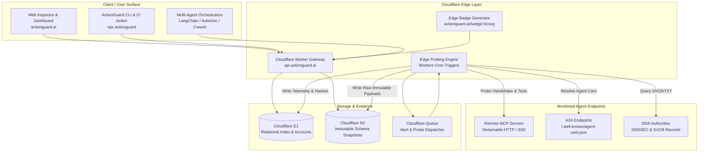

# System Architecture & Data Model

**Document:** Technical Architecture & Edge Infrastructure  
**Project:** ActionGuard.ai  
**Target Infrastructure:** Cloudflare Workers, Cloudflare D1, Cloudflare R2, Cloudflare Queues  

---

## 1. High-Level Architecture Diagram



---

## 2. Cloudflare D1 Relational Schema

The D1 database maintains accounts, registered services, endpoint configurations, watchlist subscriptions, and rolling telemetry rollups.

```sql
-- Organizations / Accounts
CREATE TABLE organizations (
    id TEXT PRIMARY KEY,
    name TEXT NOT NULL,
    slug TEXT NOT NULL UNIQUE,
    tier TEXT NOT NULL DEFAULT 'community', -- 'community', 'pro', 'platform', 'enterprise'
    created_at TEXT NOT NULL DEFAULT (datetime('now'))
);

-- Registered Services (Agents / MCP Servers)
CREATE TABLE services (
    id TEXT PRIMARY KEY,
    org_id TEXT NOT NULL REFERENCES organizations(id) ON DELETE CASCADE,
    slug TEXT NOT NULL UNIQUE,
    display_name TEXT NOT NULL,
    canonical_domain TEXT NOT NULL,
    repository_url TEXT,
    verification_tier TEXT NOT NULL DEFAULT 'unverified', -- 'unverified', 'domain_verified', 'audited'
    overall_grade TEXT NOT NULL DEFAULT 'PENDING',
    created_at TEXT NOT NULL DEFAULT (datetime('now'))
);

-- Monitored Endpoints per Service
CREATE TABLE service_endpoints (
    id TEXT PRIMARY KEY,
    service_id TEXT NOT NULL REFERENCES services(id) ON DELETE CASCADE,
    protocol TEXT NOT NULL, -- 'mcp_streamable_http', 'mcp_sse', 'a2a', 'dns_aid'
    url TEXT NOT NULL,
    auth_type TEXT NOT NULL DEFAULT 'none', -- 'none', 'oauth2', 'bearer', 'api_key'
    current_schema_sha256 TEXT,
    current_descriptions_sha256 TEXT,
    last_status TEXT NOT NULL DEFAULT 'unknown', -- 'up', 'degraded', 'auth_error', 'down'
    last_latency_ms INTEGER,
    last_checked_at TEXT,
    is_active INTEGER NOT NULL DEFAULT 1
);

-- Historical Telemetry & Drift Snapshots
CREATE TABLE snapshots (
    id TEXT PRIMARY KEY,
    endpoint_id TEXT NOT NULL REFERENCES service_endpoints(id) ON DELETE CASCADE,
    observed_at TEXT NOT NULL DEFAULT (datetime('now')),
    protocol_version TEXT,
    server_version TEXT,
    schema_sha256 TEXT NOT NULL,
    descriptions_sha256 TEXT NOT NULL,
    tool_count INTEGER NOT NULL DEFAULT 0,
    estimated_token_cost INTEGER NOT NULL DEFAULT 0,
    lint_score INTEGER NOT NULL DEFAULT 0,
    r2_payload_key TEXT NOT NULL
);

-- Detected Drift & Security Events
CREATE TABLE drift_events (
    id TEXT PRIMARY KEY,
    endpoint_id TEXT NOT NULL REFERENCES service_endpoints(id) ON DELETE CASCADE,
    from_snapshot_id TEXT NOT NULL REFERENCES snapshots(id),
    to_snapshot_id TEXT NOT NULL REFERENCES snapshots(id),
    severity TEXT NOT NULL, -- 'breaking', 'security_warning', 'non_breaking'
    change_type TEXT NOT NULL, -- 'tool_removed', 'schema_modified', 'description_mutated', 'auth_regressed'
    summary_json TEXT NOT NULL,
    detected_at TEXT NOT NULL DEFAULT (datetime('now'))
);

-- Enterprise Consumer Watchlist
CREATE TABLE watchlist_items (
    id TEXT PRIMARY KEY,
    subscriber_org_id TEXT NOT NULL REFERENCES organizations(id) ON DELETE CASCADE,
    service_id TEXT NOT NULL REFERENCES services(id) ON DELETE CASCADE,
    pinned_schema_sha256 TEXT,
    pinned_descriptions_sha256 TEXT,
    alert_webhook_url TEXT,
    notify_email TEXT,
    created_at TEXT NOT NULL DEFAULT (datetime('now'))
);

-- Indexing for high-performance lookup
CREATE INDEX idx_services_slug ON services(slug);
CREATE INDEX idx_endpoints_service ON service_endpoints(service_id);
CREATE INDEX idx_snapshots_endpoint ON snapshots(endpoint_id, observed_at DESC);
CREATE INDEX idx_drift_endpoint ON drift_events(endpoint_id, detected_at DESC);
CREATE INDEX idx_watchlist_subscriber ON watchlist_items(subscriber_org_id);
```

---

## 3. Cloudflare R2 Content-Addressed Storage Layout

All raw JSON-RPC payloads, schema definitions, and audit proofs are stored in Cloudflare R2 using deterministic content-addressing:

```
r2://actionguard-evidence/
├── payloads/
│   └── <endpoint_id>/
│       └── <schema_sha256>.json       <-- Complete raw initialize & tools/list JSON
├── manifests/
│   └── <service_slug>/
│       ├── actionguard.json           <-- Source of truth manifest
│       ├── mcp-server.json            <-- Compiled MCP registry manifest
│       └── agent-card.json            <-- Compiled A2A manifest
└── reports/
    └── <report_uuid>.json             <-- Public immutable inspection audit report
```

### Advantages of R2 Content Addressing:
1. **Deduplication:** Probes that detect no change do not write duplicate R2 objects; they merely record the timestamp in D1.
2. **Tamper-Proof Audit Trail:** If an upstream author claims *"our tool never changed"*, ActionGuard provides timestamped, cryptographic evidence of the exact JSON payload returned at that minute.
3. **Zero Egress Costs:** Cloudflare R2 charges $0 egress fees, allowing free public inspection report downloads.

---

## 4. Edge Routing Architecture

| Route | Target Worker | Purpose |
|---|---|---|
| `GET /` | Web UI | Static/SSR Inspector homepage & search |
| `POST /api/inspect` | Inspector Engine | Runs live 5-stage probe against user URL |
| `GET /api/reports/:id` | Report Engine | Fetches verified report JSON from R2 |
| `GET /badge/:service.svg`| Badge Generator | Edge-cached dynamic SVG status badge (<50ms) |
| `POST /v1/routing/resolve`| Routing Engine | Trust-aware routing resolver for orchestrators |
| `POST /api/webhooks/drift`| Alert Dispatcher | Dispatches alerts to customer Slack/Discord |
