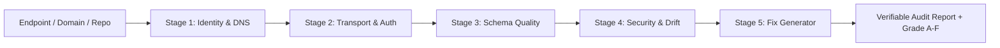

# ActionGuard.ai — Product Requirements Document (PRD)

**Version:** 1.0.0-draft  
**Status:** In Review  
**Target Domain:** `actionguard.ai` (Companion: `action-guard.com`)  
**Target Platforms:** Cloudflare Workers, Cloudflare D1, Cloudflare R2, GitHub Actions, npm CLI  

---

## 1. Executive Summary & Vision

### 1.1 The Problem
The agentic ecosystem is rapidly decentralizing. Models increasingly invoke remote tools and communicate via open protocols such as Anthropic’s **Model Context Protocol (MCP)**, Google’s **Agent2Agent (A2A)**, and **DNS-AID** (an emerging community Internet-Draft: [`draft-mozleywilliams-dnsop-dnsaid`](https://datatracker.ietf.org/doc/draft-mozleywilliams-dnsop-dnsaid/)). However, the infrastructure layer connecting agents to tools lacks operational guarantees:
- **Registries are static:** Centralized registries (like `registry.modelcontextprotocol.io`) list URLs but provide no proof that servers are reachable, performant, or backward-compatible.
- **Silent Schema Drift:** When a remote tool provider updates their tool schema without a major semver bump, downstream autonomous agents crash or hallucinate invalid arguments.
- **Tool Poisoning & Prompt Injection:** Tool descriptions are injected verbatim into the system prompts of LLM orchestrators. An unmonitored upstream tool can alter its descriptions to compromise agent execution.
- **Discovery Fragmentation:** Publishers must manually maintain multiple conflicting metadata formats (`server.json`, `agent-card.json`, DNS `SVCB`/`TXT` records).

### 1.2 The Solution: ActionGuard.ai
ActionGuard.ai is the **evidence-first verification, reliability monitoring, and drift detection SaaS** for machine-discoverable services. It operates as:
1. **The Diagnostic Layer ("SSL Labs for Agents"):** Instant public health, protocol, and security audits for any MCP or A2A endpoint.
2. **The Observability Layer ("Datadog for Agents"):** Continuous edge-based probing, latency telemetry, uptime tracking, and schema-drift alerting.
3. **The Security & Evidence Layer ("Snyk for Tools"):** Dual-hash fingerprinting to detect tool poisoning, broken schemas, and unannounced regressions.
4. **The Routing Layer ("Trust-Aware Agent Query API"):** Programmatic runtime lookup for orchestrators demanding verified, low-latency, drift-free tools.

---

## 2. Target Personas & Use Cases

### 2.1 Persona 1: The Tool & Agent Publisher ("The Builder")
- **Profile:** Solo open-source maintainers, AI startups, or SaaS engineering teams exposing an MCP or A2A interface.
- **Pain Points:** 
  - How do I publish to MCP Registry, A2A, and DNS-AID without manually authoring three distinct JSON schemas?
  - How do I prove to potential users/enterprises that my server is reliable and official?
  - How do I catch schema regressions before pushing code to production?
- **ActionGuard Value:**
  - One-click manifest compiler (`actionguard.json` -> all registry formats).
  - Public verified trust badge (`[](...)`).
  - GitHub Action to fail PRs on breaking schema changes.

### 2.2 Persona 2: The Enterprise Platform Team ("The Orchestrator / Consumer")
- **Profile:** Platform engineers, AI architects, or product teams building multi-agent workflows that consume external or third-party MCP servers.
- **Pain Points:** 
  - Our agent workflow depends on 12 third-party MCP tools. If one goes down or changes its input arguments, our agent crashes.
  - How do we know a third-party tool author hasn't altered tool descriptions to exfiltrate context?
  - How do we find compliant, low-latency fallback tools at runtime?
- **ActionGuard Value:**
  - **Enterprise Dependency Watchlist:** Pin trusted tool digests; receive instant Slack/Webhook alerts on any drift.
  - **Trust-Aware Routing API:** Query by capability with SLA, uptime, and compliance filters (`min_uptime=99.9`, `max_p95_latency=300ms`).

---

## 3. Product Modules & Functional Requirements

### Module 1: The 5-Stage Live Inspector ("SSL Labs for Agents")
A public, zero-signup inspection tool accessible via web (`actionguard.ai/inspect`) and CLI (`npx actionguard inspect <target>`).



- **FR-1.1: Stage 1 — Identity & Discovery Resolution:**
  - Query DNS-AID records (`_agents.<domain>`) for RFC 9460 `SVCB` and `TXT` entries.
  - Probe `/.well-known/agent-card.json` and `/.well-known/agent.json` for A2A metadata.
  - Check the official MCP Registry REST API for registered package or remote declarations.
- **FR-1.2: Stage 2 — Transport & Auth Handshake:**
  - Initiate MCP `initialize` JSON-RPC handshake over Streamable HTTP (`POST` with session headers) and test SSE upgrade fallback.
  - Measure Time to First Byte (TTFB) and handshake round-trip time.
  - Audit unauthenticated request handling: verify proper `401 Unauthorized` response with RFC 8414/RFC 9470 OAuth 2.1 metadata challenge rather than generic 500s or HTML login screens.
- **FR-1.3: Stage 3 — Schema Quality & Context Ergonomics:**
  - Validate JSON Schema strictness for all input parameters (`type`, `properties`, `required`).
  - Calculate **Context Token Bloat**: estimate LLM token footprint of total tools, resources, and prompts advertised.
  - Audit tool annotations (`readOnlyHint`, `destructiveHint`, `idempotentHint`, `openWorldHint`).
  - Flag missing parameter descriptions, duplicate identifiers, or ambiguous tool names.
- **FR-1.4: Stage 4 — Security & Prompt Integrity:**
  - Lint tool descriptions and A2A skill examples for prompt-injection markers, markdown exfiltration links, and suspicious Unicode.
  - Compute normalized cryptographic digests: `schema_sha256` and `descriptions_sha256`.
- **FR-1.5: Stage 5 — Instant Artifact Generator:**
  - If any protocol files are absent, auto-generate ready-to-commit files:
    - Compliant `agent-card.json` (A2A v1.0)
    - Compliant `server.json` (MCP Registry)
    - DNS zone record snippet (DNS-AID)
    - GitHub Action workflow snippet (`.github/workflows/actionguard.yml`)
- **FR-1.6: Scoring & Output:**
  - Output an overall grade (A+, A, B, C, D, F) with specific categorized line-item verdicts (`PASS`, `WARN`, `FAIL`).
  - Generate an immutable, shareable permalink (`actionguard.ai/reports/<report_id>`).

---

### Module 2: The Universal Manifest Compiler (`actionguard.json`)
A unified configuration specification that eliminates cross-protocol maintenance friction.

- **FR-2.1: Single Source of Truth:** Developers declare their service in `actionguard.json`.
- **FR-2.2: Automated Multi-Protocol Export:**
  - Compiles to MCP Registry `server.json` (including `remotes` and `packages` mappings).
  - Compiles to A2A `/.well-known/agent-card.json` (including `supportedInterfaces`, `capabilities`, and `skills`).
  - Compiles to DNS-AID zone files or Cloudflare DNS API commands.
- **FR-2.3: Bi-directional Synchronization:** Capable of importing existing `server.json` or `agent-card.json` files and generating a canonical `actionguard.json`.

---

### Module 3: Continuous Edge Probing & Telemetry Engine
A distributed, low-overhead monitoring system running on Cloudflare Workers and scheduled cron triggers.

- **FR-3.1: Probing Frequency:**
  - Free Tier: Once every 24 hours (or on-demand manual re-test).
  - Pro Tier: Every 15 minutes.
  - Team / Enterprise Tier: Every 1 to 5 minutes across multi-region edge locations.
- **FR-3.2: Metric Collection:**
  - Uptime percentage (rolling 24h, 7d, 30d, 90d).
  - p50, p95, p99 latency in milliseconds.
  - Schema version and handshake validity.
- **FR-3.3: Dual-Hash Drift Tracking:**
  - Compare latest snapshot hashes against previous baseline:
    - If `schema_sha256` changes: trigger **Structural Schema Drift Event** (Breaking Change Risk).
    - If `descriptions_sha256` changes while `schema_sha256` is identical: trigger **Silent Description Mutation Event** (Security / Prompt Poisoning Risk).
- **FR-3.4: Immutable Evidence Archival:**
  - Raw JSON payloads stored in Cloudflare R2 under `r2://evidence/<endpoint_id>/<snapshot_sha256>.json`.
  - Metrics and summaries indexed in Cloudflare D1.

---

### Module 4: Enterprise Dependency Watchlist & Alerting
Provides visibility and safety gates for teams that consume external or internal agent services.

- **FR-4.1: Watchlist Management:**
  - Users can subscribe to any public or private MCP/A2A endpoint by URL or domain.
  - Ability to **Pin a Schema Hash**: mark a specific tool definition state as approved.
- **FR-4.2: Alert Channels:**
  - Instant dispatch to Slack, Discord, Email, and generic Webhooks on:
    - Service downtime or latency spikes.
    - Breaking schema modifications.
    - Description mutations or security lint warnings.
- **FR-4.3: CI/CD Quality Gate (CLI):**
  - `npx actionguard check --pinned <hash> <url>`
  - Exits with non-zero code if the target endpoint has drifted from the pinned hash, preventing deployments of applications against modified tool dependencies.

---

### Module 5: Trust-Aware Routing & Discovery API
A programmatic REST API designed for multi-agent orchestrators (LangChain, LlamaIndex, CrewAI, AutoGen) requiring dynamic, verified tool selection.

- **FR-5.1: Capability Query Endpoint:**
  - `GET /v1/tools/search?q=financial_analysis&verified=true&min_uptime=99.9&max_latency=300`
- **FR-5.2: Safe Resolver Endpoint:**
  - `POST /v1/routing/resolve`
  - Accepts a capability requirement and returns a verified, live endpoint URL along with its pinned tool digest and fallback endpoints if the primary is degraded.
- **FR-5.3: Public Trust Badges & Embeds:**
  - Dynamic SVG status badge: `https://actionguard.ai/badge/<service-id>.svg` displaying live uptime, grade, and verification tier.

---

### Module 6: Curated Vertical Gateways (Phase 2 Expansion)
Specialized verified hubs catering to regulated industries where generic tools cannot be used:
- **Care & Family Infrastructure (`care.actionguard.ai`):** Synergistic integration with `where.care` / `families.care` datasets. Verified tools for credentialed care workers, HIPAA compliance declarations, and verified provider lookups.
- **Healthcare & Clinical (`health.actionguard.ai`):** Zero Data Retention (ZDR) validation, BAA-ready endpoints.
- **Legal & FinTech (`legal.actionguard.ai`):** Strictly audited `readOnlyHint` compliance, deterministic schema guarantees.

---

## 4. Non-Functional Requirements

### 4.1 Performance & Latency
- Public inspection requests must return preliminary results within **2,500ms**.
- Dynamic SVG status badges must be served from the Cloudflare edge cache in **< 50ms**.
- Query / Routing API lookups must execute in **< 100ms** at p95.

### 4.2 Security & Multi-Tenancy
- **Zero Raw Credential Storage:** ActionGuard probes public endpoints without requiring or storing user API keys or master credentials.
- **Sandboxed Probing:** Live probe requests are unauthenticated or use ephemeral test tokens scoped strictly to read-only capabilities.
- **Domain Verification Security:** Ownership verification requires cryptographic DNS `TXT` records or authenticated GitHub OAuth / OIDC tokens.

### 4.3 Reliability & Edge Native Architecture
- Zero single-origin server dependency; 100% of the public inspection, badge generation, and routing APIs run on Cloudflare Workers distributed across 300+ global edge locations.

---

## 5. Monetization & Tiering Strategy

| Tier | Price | Target Customer | Features |
|---|---|---|---|
| **Community** | $0 / Free | Open-source creators, solo developers | • Unlimited public web inspections<br>• Single registered public profile<br>• Daily health check<br>• Public trust badge & auto-generated manifests |
| **Pro Builder** | $29 / month | Commercial tool builders, AI SaaS | • Continuous 15-minute probing<br>• Up to 5 endpoints<br>• Schema drift alerts (Email, Discord)<br>• GitHub Action CI integration<br>• Custom badge branding |
| **Platform Team** | $199 / month | Teams consuming agent tools, orchestrators | • Up to 50 Watchlist endpoints<br>• 1-minute multi-region probing<br>• Slack & Webhook alerts on silent mutations<br>• Pinned schema enforcement & CI gating<br>• Priority edge probing |
| **Enterprise** | Custom ($15k–$50k/yr) | Enterprise AI platforms, CISO / SecOps | • Private internal MCP server probing (via tunnel/agents)<br>• SSO / SAML integration<br>• Custom compliance audits (HIPAA, ZDR, SOC2)<br>• SLA guarantee & dedicated routing pool |

---

## 6. First 90-Day Implementation Roadmap

```
Week 1 - 4: The Diagnostic Wedge (SSL Labs for Agents)
├── Ship @actionguard/core inspection library
├── Launch web UI at actionguard.ai + CLI (`npx actionguard inspect`)
├── Build Stage 1-5 probe engine (MCP Streamable HTTP, A2A, DNS-AID)
└── Onboard 25 open-source MCP builders as design partners

Week 5 - 8: Observability & Integrity Engine
├── Deploy Cloudflare D1 schema & R2 snapshot storage
├── Implement dual-hash drift engine (schema_sha256 vs descriptions_sha256)
├── Launch automated cron probing (15-min intervals)
├── Ship email & Slack alerting for breaking changes
└── Publish the public "Agent Reliability Index"

Week 9 - 12: Enterprise Watchlists & Monetization
├── Launch paid Pro ($29/mo) and Platform ($199/mo) self-serve tiers
├── Ship Watchlist dashboard with Pinned Schema enforcement
├── Release the Trust-Aware Routing API (/v1/routing/resolve)
└── Pilot the first vertical hub: care.actionguard.ai
```
